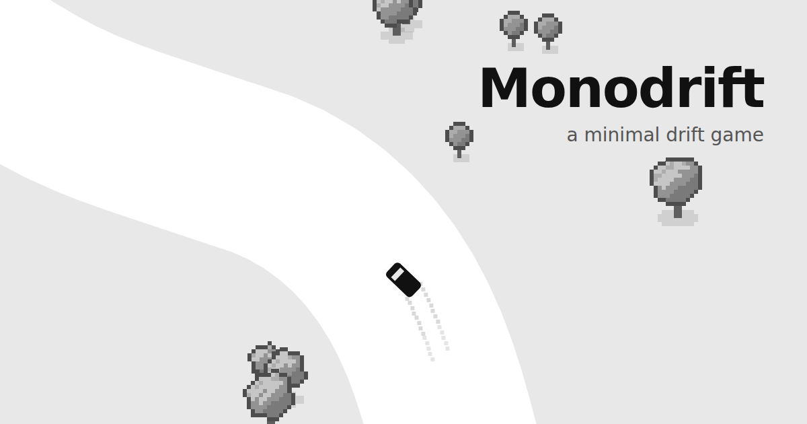

# Monodrift

[](https://monodrift.galacticquasar.dev)

A minimal top-down drift game for desktop and mobile. Stay on the road; the
car speeds up the longer you survive. Zen mode turns off crashes and scoring, and there's a dark mode in Settings.
In **Settings**, switch **Road** to *Daily* to race everyone on the same road (new one at midnight
UTC), and pick a name to get on the **leaderboard** (today and all-time).
**Drive with a friend** (on the start screen, or Friends in Settings) opens a room for up to 4:
make a new one and send the link or its 4-letter code, or type a friend's code to join. You race
on the same road with each other's cars on screen. A room picks the road, the speed, how rounds are
won (*Furthest* or *Last standing*, with a trophy for the winner) and *Zen* (no crashes, just driving).
Settings also has a **car colour**, and an *Uncapped* speed with no top speed (and a sonic boom).

**Play it:** [monodrift.galacticquasar.dev](https://monodrift.galacticquasar.dev). After the first
visit it also works offline, and it can be added to a phone's home screen.

## Controls

- **Desktop:** ← → or A/D to steer; any key (or a click) starts or retries.
- **Mobile:** hold the left/right side to steer, or switch to *Slide* mode and
  drag to aim. Tap to start.

## Develop

```bash
npm install
npm run dev        # dev server with hot reload
npm test           # unit tests (sim + scenery, no browser needed)
npm run build      # typecheck + production build into dist/
npm run preview    # serve the production build locally
npm run api        # leaderboard API locally (after a build); npm run dev proxies /api to it
```

**Pixel editor:** with `npm run dev` running, open
[`/tools/pixel-editor/`](http://localhost:5173/tools/pixel-editor/) to draw or edit the
hand-drawn pixel art in `src/art/` (it saves straight to the JSON files). Dev server only;
it isn't part of the built site.

The leaderboard API needs a `.dev.vars` file with `TICKET_SECRET=anything` for
local runs (it signs run tickets; production uses a Wrangler secret).

It's deployed to Cloudflare Workers (see `wrangler.jsonc`), which builds and
publishes every push to `main`: the static game from `dist/`, plus a small Worker
(`worker/`) for the leaderboard API at `/api/*`, backed by a D1 database. Schema
changes in `migrations/` are applied with
`npx wrangler d1 migrations apply monodrift --remote`.

### Multiplayer rooms

Each room is a Cloudflare Durable Object (`worker/room.ts`, one per 4-letter code)
holding the players' WebSockets. It only relays: every game simulates its own car
and sends its pose 15 times a second; the room passes poses on and runs the lobby,
the countdown and the results (rules in `worker/room-logic.ts`, protocol in
`src/lib/room-protocol.ts`). The other car is drawn ~120 ms behind, interpolated
(`src/net/rivals.ts`). Room rounds are Normal speed and ranked like solo runs.

To try it locally, run `npm run api` and `npm run dev`, and open the room link in two
browser windows. `?debug&bot` adds an autopilot rival to solo runs (no server needed),
for working on how rivals are drawn.

Plans and loose ends for later (ghost races, things not yet checked live) are in
[`docs/next-steps.md`](docs/next-steps.md).

### Leaderboard checks

There's no server-side replay (it would need more CPU than Cloudflare's free plan
allows). Instead, starting a run fetches a signed *run ticket* recording the start
time, and the server only accepts a score that's possible in the time since
(`maxScoreAfter`, using the car's top speed and a corner-cutting allowance). Each
ticket works once, submissions are rate-limited per player, and names are claimed
with a secret stored on the device.

## Debugging performance

Open the game with `?debug` (e.g. `http://localhost:5173/?debug`) for a frame
timing panel. **Copy report** gives a plain-text summary: frame-time spread,
each hitch with context (sim/draw time, new scenery cells, heap drops, last
game event) and Chrome's long-animation-frame breakdown.

Add `&render=…` to switch drawing layers off and isolate a problem:
`render=bg` (background only), `render=none`, `render=-trees,-skids`
(everything except these), or `render=road,car` (only these).

## Layout

```
index.html         the game page
updates.html       /updates: patch notes, filled in from docs/patch-notes.md at build time
src/
  main.ts          wiring: creates everything and starts the loop
  config.ts        every tuning constant
  loop.ts          fixed-timestep loop (120 Hz sim, interpolated rendering)
  sw.js            offline service worker template (filled in by vite.config.ts)
  sim/             the game itself: pure, deterministic, no DOM
    game.ts        GameState, phases, step(state, intent, dt, rules)
    track.ts       seeded road generation + nearest-point lookup
    car.ts         car physics
    skids.ts       skid mark emission
    scoring.ts     score rules, and the max score possible in a given time
    daily.ts       daily road seed (same road for everyone per UTC day)
    rng.ts         seeded RNG (mulberry32)
  input/           pointer + keyboard → SteerIntent
  net/             multiplayer: room WebSocket session, rival cars (pose playback), debug bot
  render/          canvas drawing (reads state, never writes it)
    renderer.ts    draws the layers: background, road, skids, firelight, car, scenery
    camera.ts      follows the car
    scenery.ts     seeded trees and campfires on a world grid, kept off the road
    sprites.ts     pixel-art sprites (procedural trees, src/art files) + the device-scaled atlas
  ui/              DOM: HUD, settings buttons, cursor auto-hide, install card,
                   leaderboard panel + name card, room card, ?debug panel
  art/             hand-drawn pixel art (*.json, one string per row) + palettes.ts
  lib/             helpers: guarded localStorage, leaderboard API client, name rules,
                   pixel-art format/validation, pose recording/packing, room protocol
worker/            Cloudflare Worker: leaderboard API (/api/*), run tickets, Room Durable Object
migrations/        D1 database schema
tests/             Vitest tests for sim/, scenery, leaderboard rules, pixel art, poses and rooms
tools/pixel-editor/ dev-only pixel editor for src/art (saves via vite.config.ts)
docs/
  art-style.md     pixel art rules and how to add new visual assets
```

**Rule of thumb:** `sim/` never touches the DOM, the clock, or `Math.random`.
Same seed + same inputs = same run, which is what makes daily roads, ghosts and
replays possible. Scenery is seeded too, so a road always gets the same forest.

Adding visual assets? Read [`docs/art-style.md`](docs/art-style.md) first.
